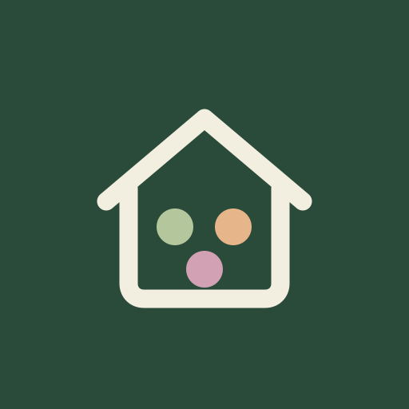

# Unser Zuhause 🏡

Eine gemeinsame Web-App für Garten, Rezepte und Ramonas Fortschritt. Die feste Navigation wechselt innerhalb desselben App-Fensters zwischen den drei Bereichen. Besuchte Bereiche bleiben im Arbeitsspeicher erhalten, damit offene Formulare beim Wechsel nicht verworfen werden.

## Zugriffe und Einbettung

Die Oberfläche zeigt ausschließlich die drei fest eingetragenen Anwendungen derselben Origin. Der Hub liest keine Auth-Tokens, Kontodaten, Fotos oder Gesundheitswerte, speichert keine persönlichen Daten und verbindet sich nicht mit Supabase. Jeder Bereich verwendet unverändert seine vorhandene Anmeldung, Sitzungsprüfung und Datenbankfreigabe. Beide freigegebenen Konten behalten ihren gemeinsamen Zugang zu Ramonas Tagebuch; andere Konten erhalten dadurch keine Rechte.

Die drei Apps erlauben eine eingebettete Ansicht ausschließlich unter dieser obersten Startseite auf derselben Origin. Der gemeinsame Bridge-Code prüft Top-Level-Elternfenster, Origin, exakten Startseitenpfad `/abnehmen/zuhause/` und den erwarteten App-Shell-Marker. Andere und verschachtelte Frames bleiben gesperrt. Die Kommunikation akzeptiert nur die festgelegten App-Namen und bekannte Frame-Fenster. Keine Tokens werden in URLs oder Nachrichten kopiert.

Direkte App-Aufrufe funktionieren weiterhin. Einfache Wechselverknüpfungen innerhalb der gemeinsamen Ansicht wechseln den Bereich der Oberfläche. Bewusst separat geöffnete Rezept-Details, externe Seiten und native Gerätefunktionen behalten ihr vorhandenes Verhalten.

## Installation

Das Manifest hat die stabile ID `/abnehmen/zuhause/` und den Geltungsbereich `/`. Browser und Betriebssystem bestimmen Installation und Fensterführung. Die erste Anmeldung in der installierten Oberfläche kann erneut nötig sein. Der Hub registriert keinen Service Worker und legt keinen Offline-Cache an. Vorhandene Service Worker der Bereiche bleiben auf ihre jeweiligen App-Pfade begrenzt.

Die Symbole stammen aus den bestehenden Projekten; es wurden keine neuen KI-Bilder erzeugt. Der Hub liegt unter `zuhause/` im vorhandenen Abnehmen-Repository. Die drei bestehenden Projekt-Repositories bleiben erhalten. Ein öffentlicher Hub-Link erteilt keine Berechtigung auf private Daten.

## Entwicklung

`npm start` startet die lokale Startseite auf http://127.0.0.1:4180/. Die drei Bereiche müssen für Integrationstests unter ihren jeweiligen Pfaden bereitstehen. `npm test` prüft die Einbettungsregeln und die sichere Navigation; die browsergestützte Integrationsprüfung nutzt zusätzlich die anderen App-Projekte.

## Performance

Nicht sichtbare Bereiche pausieren ihre regelmäßigen Datenabfragen und Anzeigeaktualisierungen. Auth-Sitzungsereignisse bleiben wirksam. Die gemeinsame Navigation wartet bei einem laufenden Wochen-Check-in auf dessen Abschluss. Der Hub berücksichtigt die aktuelle sichtbare Höhe und sichere Bildschirmränder; Touch-Eingaben erhalten passende Schrift- und Zielgrößen. Die dokumentierten Engine- und Größentests stehen im Plattformbericht des übergeordneten Projekts.

## Bedienhilfe und Impressum

Die öffentliche [Bedienhilfe](read.html), ihre [Textfassung](read.txt) und das gemeinsame [Impressum mit Datenschutzhinweisen](impressum.html) sind ohne Anmeldung erreichbar. Das Fragezeichen in Unser Zuhause öffnet allgemeine Hilfe, alle drei App-Hilfen und das Impressum direkt in einem Dialog mit gesperrtem Hintergrund. Öffnen und Schließen der Hilfe erhalten bestehende App-Eingaben. Die Dokumente verwenden ausschließlich bestätigte Betreiberangaben.

Die Hilfen verwenden passende App-Farben, vorhandene Symbole, Orientierung durch Emojis, durchsuchbare Themen und aufklappbare Abschnitte. Die öffentliche HTML-Fassung ist auch ohne JavaScript lesbar. `node scripts/build-help.mjs` erzeugt HTML-Hilfen und Impressen aus den Textfassungen für die vorhandenen Geschwister-Checkouts; die gemeinsame Darstellung liegt in `help-view.mjs` und `documents.css`. Es werden keine neuen Bilder generiert.
